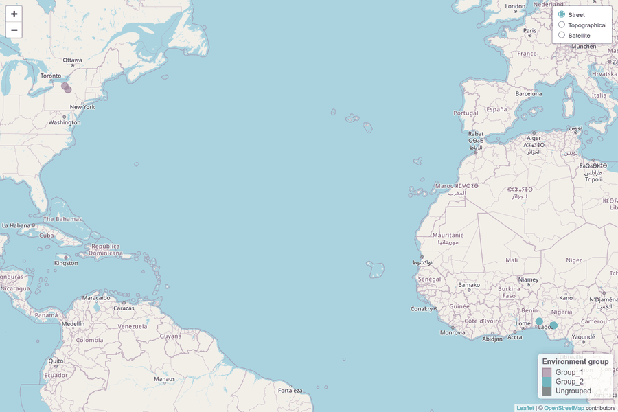

# breedtools

Design and analysis of plant breeding trials, from single trials to groups
of environments, with storage in 'Breedbase'.

- **Design** augmented row-column, augmented p-rep and resolvable
  row-column trials, or bring designs made with 'agricolae'.
- **Analyse** each trial (adjusted means, BLUPs, spatial models with
  'SpATS') and several trials together (two-stage or single-stage).
- **Group environments** that rank genotypes alike (Lin, 1982) and draw
  them on a map.
- **Save** trials, phenotypes and analysis results to 'Breedbase'
  through BrAPI.

## Installation

```r
# install.packages("remotes")
remotes::install_github("solgenomics/breedtools")
library(breedtools)
```

## Connect to Breedbase (optional)

Designs, analyses and environment groups all work offline. A connection
is only needed to check names against your database, save trials,
phenotypes and results, or read phenotypes from it. You need an account
on the site; use a test site such as
`https://cassava-test.sgn.cornell.edu` to try things out before saving to
production.

```r
con <- breedbase_login("https://cassavabase.org", username = "your_username")
con                          # site, user and time of login
breedbase_programs(con)      # breeding programs your account can see
breedbase_folders(con, program = "IITA")
breedbase_locations(con)
```

Never write your password in a script: leave it out and type it in the
pop-up, or set `BREEDBASE_PASSWORD` in your `.Renviron` file. Test sites
also have a web password (`site_username`, `BREEDBASE_SITE_PASSWORD`).
`?breedbase_connection` explains every option.

## Designs from breedtools

| Design | When to use it | Function |
|---|---|---|
| Augmented row-column (Piepho and Williams, 2016) | One plot per entry, replicated checks, one location | `augmented_row_column_design()` |
| Augmented p-rep (Williams, Piepho and Whitaker, 2011) | Several locations, part of the entries repeated, no checks | `augmented_prep_design()` |
| Resolvable row-column (Williams, John and Whitaker, 2006) | Every entry in every replicate | `resolvable_row_column_design()` |

Not sure which layout fits? Start from the number of entries:

```r
design_options(n_entries = 100)  # field dimensions and checks not yet known
design_options(108, design = "augmented_row_column", n_checks = 4, rows_in_field = 12, cols_in_field = 12)
design_options(42, design = "resolvable", n_reps = 3, cols_in_field = 7)
```

Then generate the design, look at the field map, check it and save it:

```r
rc <- augmented_row_column_design(
  treatments = sprintf("LINE_%03d", 1:108),
  controls = c("CHECK_A", "CHECK_B", "CHECK_C", "CHECK_D"),
  rows_in_field = 12, cols_in_field = 12,
  rows_per_block = 4, cols_per_block = 4,
  seed = 2026
)
plot_augmented_row_column_design(rc)

# Save it to Breedbase: check the names, preview, then save
breedbase_check(con, accessions = rc, location = "Ibadan", program = "IITA",
                folder = "AYT 2026", trial_name = "AYT_2026_Ibadan")
save_breedbase(rc, con, program = "IITA", folder = "AYT 2026",
               trial_name = "AYT_2026_Ibadan", year = 2026, location = "Ibadan",
               description = "Advanced yield trial", dry_run = TRUE)
save_breedbase(rc, con, program = "IITA", folder = "AYT 2026",
               trial_name = "AYT_2026_Ibadan", year = 2026, location = "Ibadan",
               description = "Advanced yield trial")
sheet <- phenotype_template(rc, trial_name = "AYT_2026_Ibadan", location = "Ibadan",
                            traits = "fresh root yield")   # field sheet with the plot names
```

Augmented row-column designs can have unequal row and column groups, any
number of check plots per block and D-optimal check placement. P-rep
designs are built by a randomized search or from the paper's alpha and
alpha(2) arrays (`method`), and report their efficiency factor. Resolvable
designs are optimized for row-column and spatial efficiency, with latinized
options. `add_plot_coordinates()` adds GPS coordinates to the plots before
saving.

## Designs from agricolae

Designs generated with the CRAN package 'agricolae' keep their
randomization and use the same saving workflow:

```r
accessions <- c("G1", "G2", "G3", "CHECK_A")  # existing Breedbase accession names
randomized <- agricolae::design.rcbd(accessions, r = 3, seed = 2026)
trial <- prepare_breedbase_trial(
  randomized, trial_name = "RCBD_2026", year = 2026,
  location = "Ibadan", program = "Your breeding program",
  description = "RCBD with three complete blocks generated with agricolae",
  checks = "CHECK_A", prompt = FALSE
)

payload <- save_breedbase(trial, dry_run = TRUE)   # preview, no connection needed
save_breedbase(trial, con, dry_run = TRUE)         # check against your database
save_breedbase(trial, con)                         # save as a new trial
```

`prepare_breedbase_trial()` records the trial information once and converts
the field book. In an interactive RStudio session it can ask for the
missing name, year, location, program and description. It recognizes CRD,
RCBD, alpha, lattice, augmented block, split-plot and strip-plot designs.
For a field book alone, including `agricolae::zigzag()` output, supply
`design_type`. For several treatment factors, name the accession column,
e.g. `accession = "genotype"`; the other factors stay in `trial$book`. See
`?as_breedbase_design` for the column mapping.

## Analysis

Each design has its own analysis: ANOVA with estimable degrees of freedom,
adjusted entry means (BLUEs) with standard errors, the mean SED and the 5%
LSD, or random entries (BLUPs) and 'SpATS' spatial models.

```r
field <- rc$design
field$yield <- rnorm(nrow(field), 60, 3)   # your phenotypes here
plot_trait(field, "yield")                 # distribution and field map
find_outliers(field, "yield")
fit <- analyze_augmented_row_column_design(field, response = "yield")
fit                                        # ANOVA and top adjusted means
fit$adjusted_means                         # all entries ranked
```

For trials of any design across locations, `analyze_two_stage()` analyses
each location first (spatial, blocks or design model) and then combines
them, weighting by precision and with a random genotype-by-location
interaction; `analyze_single_stage()` fits everything in one model. P-rep
designs have their own `analyze_augmented_prep_two_stage()`.

The results go back to Breedbase, with the phenotypes:

```r
save_breedbase_phenotypes(sheet, con)                  # the field sheet, filled in
stage1 <- first_stage_values(fit, rc, trial_name = "AYT_2026_Ibadan",
                             location = "Ibadan", trait = "fresh root yield")
save_breedbase_first_stage(stage1, con)                # adjusted plot values
stage2 <- second_stage_values(fit, trait = "fresh root yield")
save_breedbase_analysis(stage2, con, analysis_name = "AYT_2026_Ibadan_means",
                        program = "IITA", description = "Adjusted means, row-column model")
```

Every `save_*()` function accepts `dry_run = TRUE` to check everything
without writing.

## Environment stratification (grouping environments)

Before combining trials from several locations, check two things: are the
error variances similar enough to analyse the trials together, and which
environments rank the genotypes alike? Both run directly on a phenotype
file downloaded from 'Breedbase'. The package includes an example with four
trials:

```r
pheno_file <- system.file("extdata", "breedbase_pheno.csv", package = "breedtools")
loc_file   <- system.file("extdata", "breedbase_locations.csv", package = "breedtools")

# 1. Homogeneity of error variances (Hartley's Fmax, simulated critical value)
vc <- run_breedbase_variance_check(pheno_file, trait_col = "fresh root yield|CO_334:0000013")
vc$overall_hartley              # all four together: Fmax 5.66 > 5.20, not homogeneous
vc$maximal_compatible_groups    # largest sets of trials that can be combined

# 2. Group environments by genotype-by-environment interaction (Lin, 1982)
st <- run_environment_stratification(pheno_file, trait = "fresh root yield")
st$group_summary
#>   group_id      locations n_env    ms_ge   f_value    p_value
#> 1  Group_1 Geneva, Ithaca     2 2.259034 1.8924496 0.09774358
#> 2  Group_2 Ibadan, Ubiaja     2 4.422801 0.7875387 0.64998303

# 3. Draw the groups on an interactive map (open maps, no API key)
map_environment_groups(st, read_locations(loc_file, phenotype_data = st))
```



Environments in the same group have a non-significant GxE between them,
so they can be treated as one target environment. Your own file works the
same way: download the phenotypes of the trials from 'Breedbase' (`.csv` or
`.xlsx`) and pass its path; columns are detected automatically.
`run_environment_stratification(..., export_json = TRUE, output_dir = ...)`
also saves the results as JSON.

## Documentation

- **Website**: <https://solgenomics.github.io/breedtools/>. The
  [function reference](https://solgenomics.github.io/breedtools/reference/)
  groups every function by task and shows its arguments with examples you
  can run.
- **Tutorial**: `vignette("breedtools")` walks through every design and
  analysis with simulated data, and connecting to Breedbase.
- **RStudio script**: the whole workflow in one file,
  `file.edit(system.file("examples", "breedtools_workflow.R", package = "breedtools"))`.
  The complete tour in `scripts/validate_designs.R` (in the GitHub repository)
  also reads existing Breedbase trials and adds traits to saved analyses.
- **In R**: `help(package = "breedtools")` lists every help page.
  `?augmented_row_column_design` opens one page, and
  `example(augmented_row_column_design)` runs its examples.

## All functions

Each function has a help page with runnable examples: `?function_name`,
then `example(function_name)`. Functions that connect to Breedbase have
examples in `\dontrun{}`. To run them, you need a server and an account.

### 1. Choose a design

| Function | What it does |
|---|---|
| `design_options()` | Suggests layouts for any design from the number of entries and the field size, if you know it |
| `augmented_row_column_capacity()` | Counts the entries and checks that fit in an augmented row-column field |
| `augmented_row_column_layouts()` | Lists the analyzable block layouts of an augmented row-column field |
| `augmented_prep_parameters()` | Lists feasible settings for the alpha and alpha(2) p-rep constructions |

```r
design_options(n_entries = 100)
augmented_row_column_layouts(rows_in_field = 12, cols_in_field = 12)
augmented_prep_parameters(n_treatments = 20, n_locations = 2)
```

### 2. Augmented row-column designs (one plot per entry, replicated checks)

| Function | What it does |
|---|---|
| `augmented_row_column_design()` | Generates the design with D-optimal or Latin check placement |
| `plot_augmented_row_column_design()` | Draws the field map |
| `analyze_augmented_row_column_design()` | ANOVA and adjusted means using fixed or random blocks, random entries (BLUPs), or a SpATS model |

```r
rc <- augmented_row_column_design(paste0("G", 1:108), paste0("C", 1:4),
                                  rows_in_field = 12, cols_in_field = 12,
                                  rows_per_block = 4, cols_per_block = 4, seed = 1)
plot_augmented_row_column_design(rc)
d <- rc$design; d$yield <- rnorm(nrow(d), 50, 3)
fit <- analyze_augmented_row_column_design(d, "yield")
fit$adjusted_means
```

### 3. Augmented p-rep designs (several locations, part of the entries repeated)

| Function | What it does |
|---|---|
| `augmented_prep_design()` | Generates the design (`method = "search"`, `"alpha"` or `"alpha2"`) |
| `augmented_prep_concurrence()` | Counts how often each pair of entries shares a block |
| `plot_augmented_prep_design()` | Draws the field map of each location |
| `analyze_augmented_prep_design()` | Single-stage analysis with optional genotype-by-location interaction |
| `analyze_augmented_prep_two_stage()` | Two-stage analysis with heterogeneous error variances and optional SpATS |

```r
prep <- augmented_prep_design(paste0("G", 1:60), locations = c("North", "South"),
                              block_size = 6, field_cols = 10, seed = 1)
plot_augmented_prep_design(prep)
d <- prep$design; d$yield <- rnorm(nrow(d), 25, 3)
analyze_augmented_prep_design(d, "yield")
analyze_augmented_prep_two_stage(d, "yield")
```

### 4. Resolvable row-column designs (fully replicated)

| Function | What it does |
|---|---|
| `resolvable_row_column_design()` | Generates a spatially optimized design, including latinized options |
| `resolvable_row_column_efficiency()` | Calculates row-column, linear variance and AR efficiencies of a design |
| `plot_resolvable_row_column_design()` | Draws the field map |
| `analyze_resolvable_row_column()` | Fits RC, LV + RC or AR + RC models by REML |

```r
rr <- resolvable_row_column_design(paste0("T", 1:42), n_reps = 3,
                                   rows_per_rep = 6, cols_per_rep = 7, seed = 1)
resolvable_row_column_efficiency(rr)
plot_resolvable_row_column_design(rr)
d <- rr$design; d$yield <- rnorm(nrow(d), 40, 4)
analyze_resolvable_row_column(d, "yield", model = "rc")   # or "lv", "ar"
```

### 5. Analysis for any design

| Function | What it does |
|---|---|
| `plot_trait()` | Plots a trait's distribution and field map |
| `find_outliers()` / `remove_outliers()` | Flags or removes outlying plots with the IQR rule |
| `analyze_two_stage()` | Two-stage analysis of several trials of any design |
| `analyze_single_stage()` | Single-stage analysis of several trials, as an alternative |
| `compare_first_stage()` | Compares raw and first-stage adjusted plot values |
| `first_stage_values()` | Returns the adjusted plot values to store as a trait |
| `second_stage_values()` | Returns the genotype values to store as a Breedbase analysis |
| `prediction_accuracy()` | Correlates adjusted means with known (simulated) genotype values |

```r
plot_trait(d, "yield")
find_outliers(d, "yield")
fit2 <- analyze_two_stage(met, "yield", stage1 = "design")  # met: trials stacked with a location column
second_stage_values(fit2, trait = "fresh root yield")
```

### 6. Design checks

| Function | What it does |
|---|---|
| `check_setup()` | Checks that packages and the output folder are ready |
| `check_design()` | Runs the standard checks on any design, such as plot use, entry counts, check placement and estimable effects |
| `check_section()` / `check_result()` | Labels a section and records your own checks |
| `check_summary()` / `check_reset()` | Prints or clears the recorded checklist |

```r
check_reset(); check_design(rc); check_summary()
```

### 7. Breedbase: connect, look up and save designs

| Function | What it does |
|---|---|
| `breedbase_login()` | Logs in to a Breedbase server through BrAPI |
| `breedbase_programs()` / `breedbase_folders()` / `breedbase_locations()` | Lists breeding programs, trial folders and locations |
| `breedbase_check()` | Checks the program, folder, location, accessions, trial and plot names before you save, and says whether everything is READY |
| `add_plot_names()` | Adds the Breedbase plot names to a design, to see, check or edit them before saving |
| `add_plot_coordinates()` | Adds plot GPS coordinates, from the field corner and plot size, or one point per plot |
| `save_breedbase_coordinates()` | Saves plot GPS coordinates to a trial already in Breedbase |
| `prepare_breedbase_trial()` | Converts an agricolae design and records the trial information |
| `as_breedbase_design()` | Converts an agricolae field book only (column mapping) |
| `save_breedbase()` | Saves a design as a new trial with its plots and their GPS coordinates (`dry_run = TRUE` previews it) |
| `breedbase_trial_plots()` | Reads the plots of a saved trial |
| `phenotype_template()` | Makes a phenotyping sheet with the Breedbase plot names |

```r
con <- breedbase_login("https://your-breedbase.org", "your_username")
breedbase_programs(con)
rc <- add_plot_names(rc, "AYT_2026", location = "Ibadan")       # see rc$design$plot_name
rc <- add_plot_coordinates(rc, origin = c(7.4931, 3.9035), plot_width = 3, plot_length = 5)
breedbase_check(con, accessions = rc, location = "Ibadan", program = "Cassava",
                trial_name = "AYT_2026")
save_breedbase(rc, con, program = "Cassava", folder = "AYT 2026",
               trial_name = "AYT_2026", year = 2026, location = "Ibadan",
               description = "Advanced yield trial", dry_run = TRUE)
phenotype_template(rc, traits = "fresh root yield")      # uses the stored plot names
```

### 8. Breedbase: phenotypes and analysis results

| Function | What it does |
|---|---|
| `breedbase_phenotypes()` | Reads phenotypes of trials by trial and trait name |
| `save_breedbase_phenotypes()` | Saves phenotypes by plot and trait name |
| `save_breedbase_first_stage()` | Saves first-stage plot values as a trait of the field plots |
| `save_breedbase_analysis()` | Saves results as a Breedbase analysis, of plots (first stage) or accessions (second stage) |
| `analysis_plot_names()` | Shows the plot and accession names an analysis will have, before saving |
| `breedbase_analysis_plots()` | Reads the plots, accessions and values of an analysis already in Breedbase |
| `add_breedbase_analysis_values()` | Adds another trait to an existing analysis |
| `breedbase_statistics()` | Lists the statistic terms of the SGNSTAT ontology |
| `breedbase_adjusted_trait()` | Finds or creates the trait used for adjusted values |
| `breedbase_refresh()` | Refreshes the server's phenotype cache |

### 9. Multi-environment trials from Breedbase files

| Function | What it does |
|---|---|
| `read_breedbase_file()` / `read_breedbase_excel()` | Reads Breedbase phenotype or design files (Excel, CSV, TSV) |
| `prepare_breedbase_pheno()` | Prepares phenotypes for multi-environment analysis |
| `run_breedbase_variance_check()` | Analyzes each environment, runs Hartley's Fmax test and finds compatible groups |
| `run_environment_stratification()` | Groups environments by GxE using Lin (1982) |
| `run_breedbase_environment_stratification()` | Runs the same grouping directly from a Breedbase file |
| `read_locations()` / `map_environment_groups()` | Loads location coordinates and draws the groups on a map |

```r
pheno_file <- system.file("extdata", "breedbase_pheno.csv", package = "breedtools")
loc_file   <- system.file("extdata", "breedbase_locations.csv", package = "breedtools")
vc <- run_breedbase_variance_check(pheno_file, trait_col = "fresh root yield|CO_334:0000013")
vc$maximal_compatible_groups
st <- run_environment_stratification(pheno_file, trait = "fresh root yield")
map_environment_groups(st, read_locations(loc_file, phenotype_data = st))
```

### 10. Building blocks and helpers

The pipeline functions above call these lower-level functions. You can call
them yourself to run one step at a time.

| Group | Functions |
|---|---|
| Variance check | `analyze_environment_anova()`, `analyze_one_environment()`, `hartley_fmax_test()`, `hartley_critical_sim()`, `make_environment_groups()`, `get_compatible_groups()`, `get_maximal_groups()`, `harmonic_mean()` |
| Environment stratification | `prepare_environment_stratification_data()`, `detect_design()`, `prepare_design_factors()`, `calculate_environment_stratification_anova()`, `lin_group_environments()`, `lin_test_group()`, `lin_ss_ge()`, `lin_error_mse()`, `complete_environment_info()`, `add_environment_metadata()`, `add_pairwise_environment_metadata()`, `environment_summary_by_group()` |
| Columns and empty tables | `find_column()`, `guess_column()`, `normalize_column_name()`, `empty_anova()`, `empty_group_membership()`, `empty_group_summary()`, `empty_pairwise()`, `empty_ungrouped()` |
