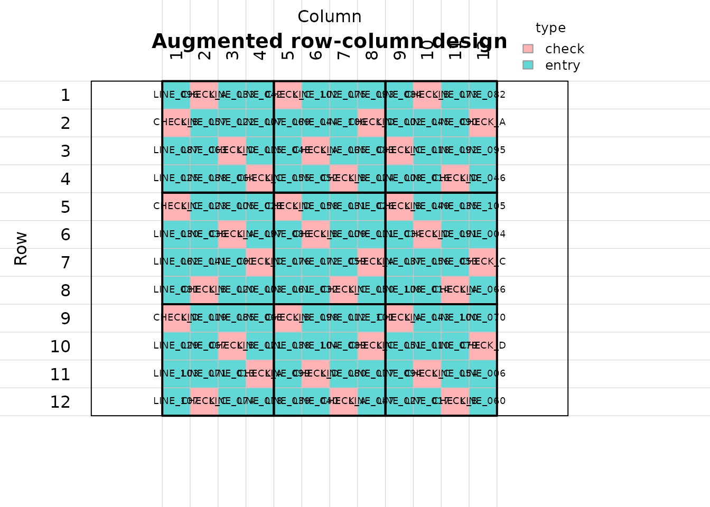

# Getting started: one trial from planning to saved results

This tutorial follows one augmented row-column trial from planning to
Field Book collection, phenotypes, analysis and saved results. The
executed examples use simulated observations and local files. Connection
and upload chunks are shown but not executed: adapt them to your own
database.

**Connect → check names → design → export field and traits → collect →
save phenotypes → analyse → save results**

``` r

library(breedtools)
trial_name <- "AYT_2026_Ibadan"
location <- "Ibadan"
trait <- "fresh root yield"
entries <- sprintf("LINE_%03d", 1:108)
checks <- c("CHECK_A", "CHECK_B", "CHECK_C", "CHECK_D")
```

## 1. Connect and check database names

Skip this step to try the example offline. For a real trial, replace the
example names with existing accessions, location, program, folder and
trait names in your Breedbase site. Omit the password to enter it
privately.

``` r

con <- breedbase_login("https://your-breedbase.org", username = "your_username")
breedbase_programs(con)
breedbase_locations(con)
breedbase_folders(con, program = "Your breeding program")
breedbase_check(con, accessions = c(entries, checks), location = location,
                program = "Your breeding program", folder = "AYT 2026",
                trial_name = trial_name)
```

Resolve any missing names or existing trial-name conflicts before
saving.

## 2. Design and save the trial

Our 12 × 12 field holds 108 test entries and 36 check plots. Each 4 × 4
block contains the four checks. The seed makes the layout reproducible.

``` r

rc <- augmented_row_column_design(
  treatments = entries, controls = checks,
  rows_in_field = 12, cols_in_field = 12,
  rows_per_block = 4, cols_per_block = 4, seed = 2026
)
check_design(rc)
#> Checking the augmented row-column design
#>   [OK]   every plot used exactly once
#>   [OK]   every entry planted exactly once
#>   [OK]   every field row has a check
#>   [OK]   every field column has a check
#>   [OK]   check plots per block as requested
#>   [OK]   error df > 0 (6)
#>   [OK]   row, column and block effects estimable from the checks
#>   [OK]   checks spread evenly in each block (every check in full blocks)
#>   [OK]   even numbers of check plots in the rows and columns of each group
#>   [OK]   every check in each row and column with room for all checks
#>   [OK]   no checks next to each other inside a block (0 pairs)
#>   [OK]   no checks next to each other across block boundaries (0 pairs)
#>   [OK]   no check twice in a field row or column
plot_augmented_row_column_design(rc)
```



Preview the trial locally. No database is changed by a dry run.

``` r

payload <- save_breedbase(
  rc, trial_name = trial_name, year = 2026, location = location,
  program = "Your breeding program", folder = "AYT 2026",
  description = "Advanced yield trial", dry_run = TRUE
)
#> Dry run without a connection: returning the data that would be sent.
```

For a real trial, validate against the database and then save:

``` r

save_breedbase(rc, con, trial_name = trial_name, year = 2026,
  location = location, program = "Your breeding program", folder = "AYT 2026",
  description = "Advanced yield trial", dry_run = TRUE)
save_breedbase(rc, con, trial_name = trial_name, year = 2026,
  location = location, program = "Your breeding program", folder = "AYT 2026",
  description = "Advanced yield trial")
```

## 3. Export field and trait files for offline collection

[`phenotype_template()`](https://solgenomics.github.io/breedtools/reference/phenotype_template.md)
gives the plots the same names as the database upload. Leave its
`traits` argument empty for a Field Book field file; measurements are
defined separately by
[`trait_template()`](https://solgenomics.github.io/breedtools/reference/trait_template.md).

``` r

output_dir <- tempdir()  # use a persistent folder for your real trial
field <- phenotype_template(rc, trial_name, location = location)
field_file <- file.path(output_dir, "AYT_2026_Ibadan.csv")
write.csv(field, field_file, row.names = FALSE, na = "")
traits <- trait_template(
  trait, minimum = 0, details = "Fresh root yield in t/ha",
  output_file = file.path(output_dir, "AYT_traits.trt")
)
head(field)
#> # A tibble: 6 × 9
#>   plot_name    trial_name accession plot_number block   rep   row   col is_check
#>   <chr>        <chr>      <chr>           <int> <int> <int> <int> <int> <lgl>   
#> 1 AYT_2026_Ib… AYT_2026_… LINE_096            1     1     1     1     1 FALSE   
#> 2 AYT_2026_Ib… AYT_2026_… CHECK_A             2     1     1     1     2 TRUE    
#> 3 AYT_2026_Ib… AYT_2026_… LINE_033            3     1     1     1     3 FALSE   
#> 4 AYT_2026_Ib… AYT_2026_… LINE_042            4     1     1     1     4 FALSE   
#> 5 AYT_2026_Ib… AYT_2026_… CHECK_C             5     2     2     1     5 TRUE    
#> 6 AYT_2026_Ib… AYT_2026_… LINE_102            6     2     1     1     6 FALSE
traits
#> # A tibble: 1 × 9
#>   trait         format defaultValue minimum maximum details categories isVisible
#>   <chr>         <chr>  <chr>        <chr>   <chr>   <chr>   <chr>      <chr>    
#> 1 fresh root y… numer… ""           0       ""      Fresh … ""         true     
#> # ℹ 1 more variable: realPosition <int>
```

Transfer these files to the Android device by USB or your preferred file
transfer method. No mobile BrAPI connection is required.

1.  In Field Book’s **Fields**, import the CSV. Select `plot_name` as
    the unique identifier, `row` as primary and `col` as secondary
    identifier. For designs without coordinates, use `plot_number` and
    `accession` for navigation instead. Plot names must be unique across
    your fields.
2.  In **Traits \> Import/Export**, import `AYT_traits.trt`. These
    definitions configure the app; they do not create ontology terms in
    Breedbase.
3.  Collect the measurements offline.
4.  Export in **Table** format with **all imported columns**, including
    `plot_name`, and transfer the resulting CSV back to your computer.

The app’s
[field](https://field-book.readthedocs.io/en/latest/fields.html),
[trait](https://field-book.readthedocs.io/en/latest/traits.html) and
[export](https://field-book.readthedocs.io/en/latest/export.html)
documentation explains these options. Table format retains only the
first repeated measurement. For repeated observations, use Database
format and map its plot, trait, value and timestamp columns explicitly
in
[`save_breedbase_phenotypes()`](https://solgenomics.github.io/breedtools/reference/save_breedbase_phenotypes.md).

## 4. Read and save the phenotypes

For this walkthrough, simulate a completed field sheet and write it to
CSV. In practice, use the file exported by Field Book instead.

``` r

set.seed(2026)
observed <- field
observed[[trait]] <- round(rnorm(nrow(field), mean = 25, sd = 3), 2)
observations_file <- file.path(output_dir, "AYT_2026_Ibadan_observed.csv")
write.csv(observed, observations_file, row.names = FALSE, na = "")
```

Preserve trait names, including spaces, when reading. Read identifiers
as text so they are not reformatted. Select measurement columns
explicitly so metadata added by the app is not treated as a trait.

``` r

observed <- read.csv(observations_file, check.names = FALSE,
                     colClasses = "character", na.strings = c("", "NA"))
observations <- save_breedbase_phenotypes(observed, traits = trait, dry_run = TRUE)
#> Dry run without a connection: returning the observations that would be sent.
```

The trial’s plots and the trait must already exist before uploading:

``` r

save_breedbase_phenotypes(observed, con, traits = trait, dry_run = TRUE)
save_breedbase_phenotypes(observed, con, traits = trait)
```

## 5. Analyse the collected observations

Match on `plot_name` rather than relying on the CSV row order. This also
keeps design columns in their original types for analysis.

``` r

stopifnot(!anyDuplicated(observed$plot_name),
          setequal(observed$plot_name, field$plot_name))
values <- as.numeric(observed[[trait]][match(field$plot_name, observed$plot_name)])
design_rows <- match(rc$design$plots, field$plot_number)
analysis_data <- rc$design
analysis_data$yield <- values[design_rows]
fit <- analyze_augmented_row_column_design(analysis_data, response = "yield")
head(fit$adjusted_means)
#> # A tibble: 6 × 8
#>    rank genotype type  is_control n_observations raw_mean adjusted_mean
#>   <int> <chr>    <chr>      <int>          <int>    <dbl>         <dbl>
#> 1     1 LINE_006 entry          0              1     32.9          37.5
#> 2     2 LINE_046 entry          0              1     26.8          35.9
#> 3     3 LINE_004 entry          0              1     24.6          34.3
#> 4     4 LINE_060 entry          0              1     26.8          33.7
#> 5     5 LINE_082 entry          0              1     22.8          33.3
#> 6     6 LINE_095 entry          0              1     28.5          33.1
#> # ℹ 1 more variable: std_error <dbl>
```

For real observations, investigate unexpected values and missing plots
before fitting.
[`plot_trait()`](https://solgenomics.github.io/breedtools/reference/plot_trait.md)
and
[`find_outliers()`](https://solgenomics.github.io/breedtools/reference/find_outliers.md)
can help.

## 6. Save the analysis results

Convert the adjusted means into the standard format and preview them
locally. This stores genotype means as a Breedbase analysis.

``` r

means <- second_stage_values(fit, trait = trait)
analysis_payload <- save_breedbase_analysis(
  means, analysis_name = paste0(trial_name, "_means"),
  program = "Your breeding program",
  description = "Adjusted means from the row-column model", dry_run = TRUE
)
#> Dry run without a connection: returning the upload that would be sent (trait names and the statistic are completed from Breedbase when connected).
```

``` r

save_breedbase_analysis(means, con, analysis_name = paste0(trial_name, "_means"),
  program = "Your breeding program",
  description = "Adjusted means from the row-column model", dry_run = TRUE)
save_breedbase_analysis(means, con, analysis_name = paste0(trial_name, "_means"),
  program = "Your breeding program",
  description = "Adjusted means from the row-column model")
```

For adjusted plot-level values, see
[`first_stage_values()`](https://solgenomics.github.io/breedtools/reference/first_stage_values.md)
and
[`save_breedbase_first_stage()`](https://solgenomics.github.io/breedtools/reference/save_breedbase_first_stage.md).
The full
[`vignette("breedtools")`](https://solgenomics.github.io/breedtools/articles/breedtools.md)
covers other designs, spatial models and analyses across locations.
